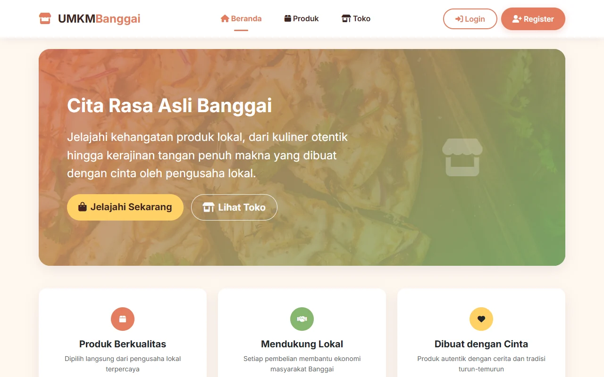

# UMKM Banggai (Salakan) — Marketplace Lokal

Platform e-commerce pemberdayaan pelaku UMKM Salakan, Banggai Kepulauan — menghubungkan penjual lokal dengan pembeli serta integrasi pembayaran **iPaymu**.

### Peran Sistem

| Pembeli | Penjual (UMKM) | Administrator |
| :--- | :--- | :--- |
| Katalog produk lokal & pencarian | Manajemen profil toko & etalase | Verifikasi pendaftaran toko baru |
| Keranjang belanja & riwayat order | Kelola produk, stok & status pesanan | Manajemen pengguna & kategori |
| Ulasan produk & checkout iPaymu | Laporan penjualan & balas ulasan | Pemantauan statistik platform |

Skema database & environment template tersedia di [`database/`](database/) dan [`.env.example`](.env.example).
